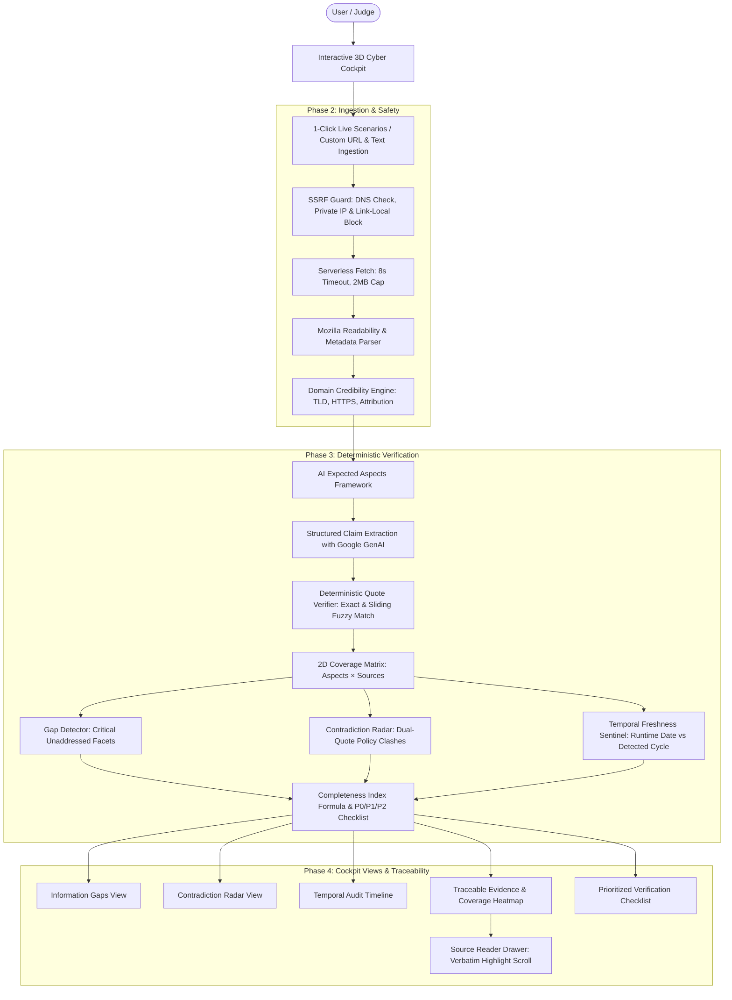

# Digital Dark Spot (DarkSpot AI Intelligence)
### AI-Assisted Information Gap & Contradiction Detection Platform
> **Shinchan Online Hackathon 2026** — Problem Track: *Digital Dark Spot*  
> *Shining an unapologetic light on what is missing, contradictory, and outdated in critical decision research.*

---

## 🎯 The Core Problem & Hackathon Context

People make life-altering decisions (scholarships, visa compliance, research grants, healthcare, public benefits) based on scattered, outdated, and conflicting online documentation.

**Search engines find what exists; summarizers condense what exists.** Neither tells you:
1. **WHAT IS MISSING:** Critical unaddressed eligibility rules, hidden fees, or renewal caveats.
2. **WHAT CLASHES:** Direct policy contradictions across institutions, dates, or dollar ceilings.
3. **WHAT IS STALE:** Expired cycles and obsolete guidelines presented as current advice.
4. **WHAT IS UNVERIFIED:** AI hallucinations passed off as factual claims.

**Digital Dark Spot** solves this fundamental blind spot with a deterministic, evidence-locked audit platform that separates verified verbatim facts from AI suggestions and illuminates hidden decision risks.

---

## 💎 Product Principles & Non-Negotiable Guarantees

1. **Evidence-Locked Claims:** Every claim displayed as `SOURCED` must possess a verbatim quote verified against the server-fetched source text (normalized whitespace/case/punctuation and sliding-window fuzzy matching). If verification fails, the claim is permanently downgraded to `UNVERIFIED`.
2. **Honest Uncertainty:** Never claims information "does not exist in the world"—strictly specifies that facts were *"not found in the sources reviewed"* or flags *"possible conflicts"*.
3. **Three Trust Labels Everywhere:** Distinguished by icon, text, and border style:
   - 🛡️ **`SOURCED`** (Solid teal border, quote icon): Verbatim quote with character offset and direct link.
   - ✨ **`AI-SUGGESTED`** (Dashed violet border, sparkle icon): Inference, synthesis, or priority checklist action.
   - ❓ **`UNCERTAIN`** (Hatched slate border, help icon): Unverified, low confidence, or partial signal.
4. **Traceable Passage Highlighting:** Clicking any claim or cell opens the **Source Reader Drawer**, automatically scrolling to and highlighting the exact excerpt in the full document text.
5. **Deterministic Code Over LLM Heuristics:** Quote offsets, domain credibility scores (TLD, HTTPS, author), academic cycle dates, and the Completeness Index are computed in pure TypeScript. AI is reserved strictly for semantic extraction and synthesis.
6. **Demo-Proof Sample Mode:** Built-in offline sample packs with precomputed audits (Aurora STEM Scholarship, STEM OPT Extension, 2026 Clean Energy EV Credit) work with zero network or API keys.

---

## 🏗️ System Architecture



---

## ⚡ 60-Second Demo Walkthrough for Judges

1. **Top Bar & 3D Cyber Cockpit:**
   - Observe the **Interactive 3D Prisms Canvas** with mouse/touch orbit rotation and floating holographic information nodes.
   - Notice the **Information Completeness Bar** (54% Sourced vs 46% Unverified Dark Spot).
   - Review the 3 Big Metric Tiles: **GAPS (4 Dark spots)**, **CLASH (2 Contradictions)**, **STALE (2 Outdated cycles)**.
2. **1-Click Live Scenarios for Judges:**
   - Click between the 3 instant scenarios in the cockpit or the scenario cards below:
     - *STEM Scholarship (PDF Official Use Case)*: 4 gaps, 2 conflicts, 2 stale dates.
     - *STEM OPT 24-Month Visa Rules*: 10-day federal vs 21-day university reporting window conflict.
     - *2026 Clean Energy EV Tax Credit*: MSRP cap clash ($55k vs $65k) and missing FEOC battery lists.
3. **Explore Dashboard Views:**
   - **Information Gaps:** Inspect the missing renewal criteria with "Why It Matters" decision risk.
   - **Contradiction Radar:** Review the side-by-side $45,000 vs $55,000 family income ceiling clash with benign institutional explanations.
   - **Temporal Audit:** Spot the 2024 archived blog flagged as an older cycle relative to runtime 2026.
   - **Traceable Evidence:** Click any cell in the 2D Aspects × Sources Matrix to open the **Source Reader Drawer** with auto-scrolled highlighted passages.
   - **Verification Checklist:** Check off prioritized P0/P1 tasks with links to official foundation portals.
4. **Audit Export & Explainer Dialog:**
   - Click **"Why Gaps Matter"** in the top bar to inspect the comparison vs generic chatbots.
   - Click **"Export"** to download the complete report as Markdown (.md) or JSON (.json).

---

## 📊 Judging Criteria Alignment (10/10 Marks)

| Criteria | Weight | How Digital Dark Spot Delivers |
| :--- | :---: | :--- |
| **Problem Relevance** | 15% | Directly tackles information absence, policy clashes, and outdated data rather than merely summarizing. |
| **Innovation Beyond Search / Chatbots** | 20% | Replaces silent LLM hallucinations with an explicit Dark Spot Illuminator, dual-quote contradiction radar, and deterministic coverage matrix. |
| **Working Prototype** | 25% | Complete working Next.js App Router application with interactive 3D cockpit, 5 findings views, source ingestion, and reader drawer. |
| **Technical Quality** | 15% | SSRF-guarded fetch, strict Zod schemas, Vitest deterministic test suite, pure TypeScript lib architecture, and zero build warnings. |
| **Evidence / Accuracy / Transparency** | 15% | Three Trust Labels (Sourced / AI-Suggested / Uncertain), verbatim quote verification, character offsets, and auto-scrolled passage highlighting. |
| **Presentation / Demo** | 10% | 3D Spline interactive canvas, 1-click judge scenarios, dark cybernetic aesthetic, and instant offline evaluation. |

---

## 🛠️ Tech Stack

- **Framework:** Next.js 16 (App Router, Turbopack, React 19)
- **Language:** TypeScript 5.7 (Strict mode enabled)
- **Styling:** Tailwind CSS v4 + Custom Cyber Holographic Design Tokens
- **Icons & Motion:** Lucide React & Framer Motion
- **State Management:** Zustand with local storage persistence
- **Verification Engine:** Pure TypeScript deterministic quote verifier (exact, normalized, sliding-window Jaccard)
- **Scraping & Safety:** `@mozilla/readability`, `jsdom`, `cheerio`, SSRF Guard with DNS validation
- **Testing:** Vitest 3 (Unit tests for SSRF, Quote Verifier, and Completeness Index)

---

## 🚀 Running the Project

### Prerequisites
- Node.js 20+ installed
- npm or pnpm

### Setup
```bash
# Clone the repository
git clone https://github.com/rajkarwarkar/shinchan-online-hackathon.git
cd shinchan-online-hackathon

# Install dependencies
npm install

# Run unit tests
npm run test

# Build for production
npm run build

# Start the application
npm run start
```
*Note: Set `GEMINI_API_KEY` in `.env.local` to enable live web extraction with Google Generative AI, or use the built-in offline Sample Mode without any API keys.*
